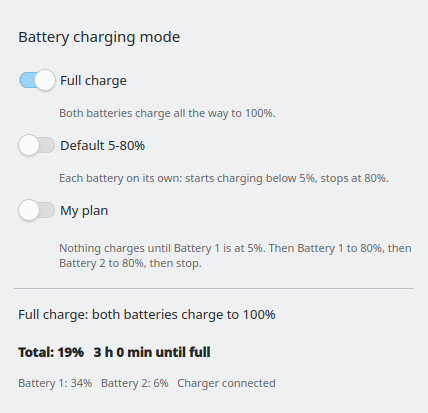

# Battery Mode



A KDE Plasma 6 system-tray widget plus a tiny background service that gives a
ThinkPad with **two batteries** three charging modes, switchable from the panel:

| Mode | What it does |
|------|--------------|
| **Full charge** | Both batteries charge all the way to 100 %. |
| **Default 5-80 %** | Each battery starts charging below 5 % and stops at 80 % (the usual battery-health setting). |
| **My plan** | Nothing charges until Battery 1 is down to 5 %. Then Battery 1 charges to 80 %, then Battery 2 charges to 80 %, then charging is held off again. Keeps one battery resting while the other cycles. |

All three switches off means "leave the firmware limits exactly as they are".

The popup also shows the combined charge of both batteries with the time
remaining, and the tray icon carries an **F**, **D** or **P** badge for the
active mode. On a one-battery machine the Full and Default modes still work;
the plan only makes sense with two batteries.

## Requirements

- KDE Plasma 6 (tested on 6.8) with `upower` installed (it always is with Plasma).
- A laptop whose kernel driver exposes charge thresholds in sysfs:
  `/sys/class/power_supply/BAT0/charge_control_start_threshold` and
  `charge_control_end_threshold`. ThinkPads do through `thinkpad_acpi`.
- Python 3 and systemd for the background service.

## Install

```sh
git clone https://github.com/mizhar-developer/battery-mode.git
cd battery-mode
./install.sh
```

`install.sh` installs the widget for your user with `kpackagetool6` and then
asks for the administrator password once to install the service
(`/usr/local/bin/battery-mode-daemon`, `/etc/systemd/system/battery-mode.service`).
Afterwards, if the icon is not in the tray: right-click the tray, choose
*Configure System Tray…*, open *Entries* and set *Battery Mode* to *Shown*.

Installing only the widget from the KDE Store works too, but without the
service the switches do nothing; the popup then says so and links here.

## How it works

- The widget writes one word (`off`, `full`, `default`, `plan`) to
  `/var/lib/battery-mode/mode`. The installer makes that file writable by your
  user, so no password is needed when switching.
- The service (`battery-mode-daemon`, running as root) reads the mode every
  3 seconds and applies the matching charge thresholds through sysfs. It writes
  `/var/lib/battery-mode/status.json`, which the widget shows in the popup.
- The plan is implemented with thresholds only. A "parked" battery gets the
  pair 1/5 so that it does not charge; a charging battery gets 79/80. On the
  ThinkPad T550 this is the only reliable way: the firmware cannot block the
  rear battery alone through `charge_behaviour`.
- Leaving the plan restores 5-80 % on both batteries.

The daemon can be tried without root against a fake sysfs tree:

```sh
BATTERY_MODE_SYSFS=/path/to/fake BATTERY_MODE_DIR=/tmp/bm ./daemon/battery-mode-daemon --once
```

## Uninstall

```sh
./uninstall.sh
```

This removes the widget and the service. The charge thresholds stay as they
were last set; change them in *System Settings › Power Management* if needed.

## License

MIT, see `LICENSE`.
